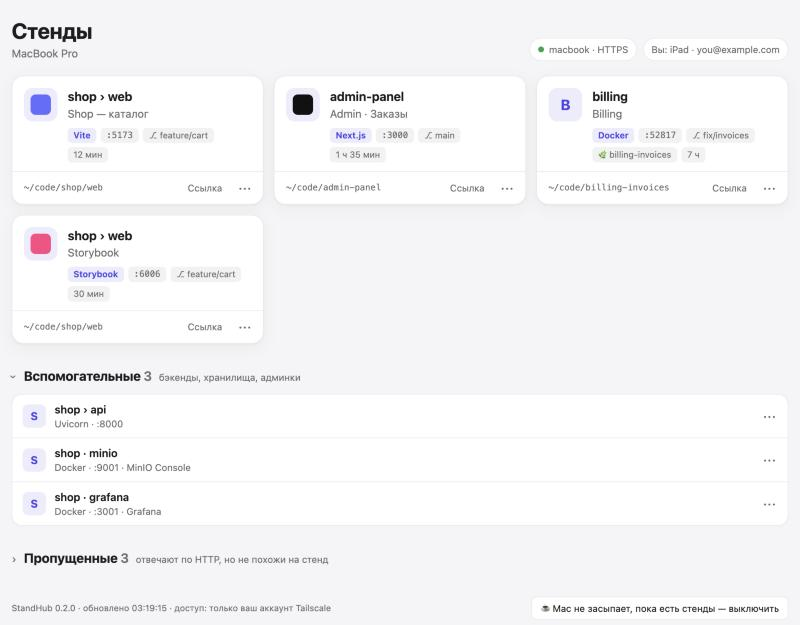

# StandHub

**Локальные dev-стенды Mac на iPad и iPhone — из любой сети и только для твоих устройств.**

Запускаешь на Mac dev-сервер (`npm run dev`, `docker compose up`, `rails s`…), и через пару секунд он
появляется на странице, открытой на iPad. Тап по карточке — и стенд открывается по HTTPS, хоть из
кафе, хоть по LTE. Удобно, когда правишь код с iPad (через Claude Code, SSH и т.п.) и хочешь сразу
проверить результат.



**Скачать:** [последний релиз (DMG для macOS 13+, Apple Silicon и Intel)](https://github.com/dkurkaev/StandHub/releases/latest) ·
[установка](#установка)

## Как это устроено

```
 iPad (Safari)  ── Tailscale (WireGuard, любая сеть) ──▶  Mac: 100.x.y.z
   https://macbook.tail1234.ts.net:7777   →  дашборд StandHub
   https://macbook.tail1234.ts.net:5173   →  прокси StandHub  →  localhost:5173 (Vite)
   https://macbook.tail1234.ts.net:52817  →  прокси StandHub  →  localhost:52817 (Docker, billing-wt-1a2b.localhost)
```

* **Сеть и вход — Tailscale.** У Apple нет сервиса, который соединяет устройства одного Apple ID
  для обычного HTTP («Back to My Mac» закрыт в 2019 году). [Tailscale](https://tailscale.com) —
  частная сеть твоих устройств поверх WireGuard: проходит через NAT и чужой Wi-Fi, вход через
  Sign in with Apple, Google или GitHub, для личного использования бесплатна.
* **Всё остальное — StandHub.** Приложение для Mac находит запущенные стенды, публикует их порты
  в сети Tailscale через обратный прокси, показывает дашборд и пускает только устройства
  твоего аккаунта.

## Возможности

* **Автопоиск стендов на любом порту.** Каждые 2,5 с StandHub просматривает все слушающие порты и
  проверяет их по HTTP. Шум отсекается: системные службы, обычные приложения (Spotify, Telegram,
  редакторы), базы данных, Redis.
* **Карточка стенда:** проект (git-репозиторий, `package.json`, монорепо), ветка и worktree,
  фреймворк (Vite, Next.js, Storybook, Django, Rails и ещё около 25), заголовок и иконка страницы,
  время работы.
* **Основные, вспомогательные и пропущенные.** Фронтенды — крупными карточками; API, метрики и
  админки (MinIO, Grafana, pgAdmin…) — в свёрнутом разделе «Вспомогательные»; порты, которые
  отвечают по HTTP, но отфильтрованы, — в «Пропущенных» с кнопкой «Показать».
* **Docker и compose-стеки.** Стенд за Envoy/Traefik/nginx, который маршрутизирует по имени хоста,
  определяется сам (`<проект>.localhost`), имя и ветка берутся из папки стека.
* **Стенд видит запрос так, будто его открыли на самом Mac.** Прокси переписывает `Host`, `Origin`,
  `Referer` (Vite, Django, Rails не блокируют «чужой» хост), а обратно — `Location`, CORS, cookie и
  адреса `http://localhost:PORT` внутри HTML/JS/JSON. Работают WebSocket (HMR), SSE и большие загрузки.
* **HTTPS** с настоящим сертификатом `*.ts.net` от Tailscale, на том же порту, что и HTTP.
  Нужен для камеры, Service Worker, буфера обмена в Safari.
* **Только твои устройства.** Каждое подключение проверяется через `tailscale whois`: устройство
  должно принадлежать тому же аккаунту, что и Mac. В локальной сети прокси не виден.
* **Приложение для Mac:** значок в Dock с числом стендов, окно с дашбордом, меню по правому клику,
  QR-код для iPad, автозапуск при входе, режим «не давать Mac засыпать».

## Требования

* macOS 13 или новее, Apple Silicon или Intel.
* [Node.js](https://nodejs.org) 18+ — на нём работает сервер (`brew install node`). Приложение
  находит `node` в `/opt/homebrew/bin`, `/usr/local/bin` или через login-shell (nvm, fnm, volta).
* [Tailscale](https://tailscale.com/download) на Mac и на iPad/iPhone, вход в один аккаунт.
* Для сборки из исходников — Xcode или Command Line Tools (`xcode-select --install`).

## Установка

### 1. Tailscale

1. **Mac:** установи Tailscale с [tailscale.com/download/mac](https://tailscale.com/download/mac)
   (Standalone-версия предпочтительнее: у неё без ограничений работают CLI и `tailscale cert`)
   или из Mac App Store. Войди в аккаунт.
2. **iPad / iPhone:** установи Tailscale из App Store и войди **в тот же аккаунт**.
3. **HTTPS** (рекомендую): в [админке Tailscale → DNS](https://login.tailscale.com/admin/dns)
   включи **MagicDNS** и **HTTPS Certificates**. Сертификат StandHub получит сам.

### 2. StandHub на Mac

#### Вариант А — из DMG

1. Скачай `StandHub-<версия>.dmg` со страницы [Releases](https://github.com/dkurkaev/StandHub/releases/latest)
   или собери сам (см. [«Упаковка в DMG»](#упаковка-в-dmg)).
2. Открой DMG и перетащи **StandHub** в **Applications**.
3. Запусти StandHub из Launchpad или Finder.

   Приложение подписано без сертификата разработчика (ad-hoc) и не нотаризовано, поэтому на
   другом Mac при первом запуске macOS напишет, что не может проверить приложение. Разреши запуск
   одним из способов:
   * «Системные настройки» → «Конфиденциальность и безопасность» → внизу «Всё равно открыть»;
   * или в Терминале:
     ```bash
     xattr -dr com.apple.quarantine /Applications/StandHub.app
     ```
   На том Mac, где DMG собран, предупреждения не будет.
4. Значок StandHub появится в Dock. При первом запуске приложение включает себе автозапуск при
   входе в систему (macOS покажет уведомление; выключается в меню приложения).

#### Вариант Б — из исходников

```bash
git clone https://github.com/dkurkaev/StandHub.git
cd StandHub
./install.sh
```

`install.sh` собирает приложение, кладёт его в `/Applications` (или `~/Applications`, если нет прав),
закрывает предыдущую версию и запускает новую. В конце печатает адрес для iPad.

### 3. iPad

1. Включи Tailscale на iPad.
2. Открой в Safari адрес дашборда — он есть в окне StandHub на Mac, например
   `https://macbook.tail1234.ts.net:7777`. Быстрее: на Mac правый клик по значку StandHub в Dock →
   **«QR-код для iPad…»** и наведи на экран камеру iPad.
3. «Поделиться» → **«На экран „Домой“»** — дашборд будет открываться как приложение.

Адрес постоянный: он меняется, только если переименовать Mac в Tailscale или сменить порт дашборда.

## Как пользоваться

**На Mac**
* Клик по значку в Dock — окно с дашбордом. Закрытие окна не останавливает сервер; полностью
  StandHub останавливается через ⌘Q.
* Правый клик по значку в Dock (или меню «Стенды» в верхней панели): стенды, «Вспомогательные»,
  адрес и QR-код для iPad, «Не давать Mac засыпать», автозапуск, настройки, лог, перезапуск сервера.
* Число на значке — количество запущенных основных стендов.
* Можно включить ещё и значок в строке меню («Значок в строке меню»); на MacBook с вырезом он
  может прятаться, поэтому по умолчанию основной вход — Dock.

**На iPad**
* Тап по карточке открывает стенд. «Ссылка» копирует адрес.
* Меню **•••** на карточке: переименовать, перенести в «Вспомогательные»/«Основные»,
  скрыть стенд (он перестаёт быть доступен извне).
* «Пропущенные» → **«Показать»** — открыть доступ к порту, который StandHub отфильтровал сам.

## Как StandHub находит стенды

1. **Все слушающие порты** твоих процессов (`lsof`), от 1024 до 65535.
2. **Процесс:** системные службы и обычные приложения отбрасываются; рантаймы (node, python, java,
   ruby, go…) и Docker остаются. Служебные порты Claude Code и языковых серверов редакторов
   тоже не считаются стендами.
3. **Проба HTTP:** запрос `GET /`. Не отвечает по HTTP (Postgres, Kafka…) — не стенд. Для compose-стека
   дополнительно пробуется имя `<проект>.localhost` и `<сервис>.<проект>.localhost`.
4. **Правило по порту:**
   * **1024–49151** — показывается любой HTTP-ответ: HTML-страница → «Основные», остальное →
     «Вспомогательные»;
   * **49152+ и порты контейнеров** — показываются, только если на `/` настоящая HTML-страница.
     Остальное (API, служебные порты) попадает в «Пропущенные».

Чего StandHub сам не подхватит и как это поправить в `config.json`:

* JSON-API на случайном высоком порту → кнопка «Показать» в «Пропущенных» (или `includePorts`);
* стенд, которому нужно особое имя хоста, и это не compose-стек → `hosts`;
* сервер, запущенный через `sudo` или на порту ниже 1024 → не виден (чужие процессы StandHub не видит).

## Настройки

Файл `~/.config/standhub/config.json` (открывается из меню: «Настройки (config.json)»).
Перечитывается на лету, перезапуск не нужен.

| Ключ | По умолчанию | Что делает |
|---|---|---|
| `dashboardPort` | `7777` | порт дашборда |
| `auth` | `"same-user"` | `same-user` — только устройства твоего аккаунта Tailscale; `tailnet` — любое устройство твоей сети; `none` — без проверки |
| `allowUsers` | `[]` | дополнительные логины Tailscale, которым можно (например, коллега в общей сети) |
| `https` | `"auto"` | `false` — не выпускать сертификат |
| `rewriteHost` | `true` | переписывать `Host`/`Origin`/`Referer` на адрес стенда |
| `rewriteBody` | `true` | заменять адреса стендов внутри HTML/JS/JSON/CSS на адрес для iPad |
| `hosts` | `{}` | имя хоста для порта: `{ "52817": "app.localhost" }` |
| `kinds` | `{}` | ручная группа стенда: `"app"` — основные, `"service"` — вспомогательные |
| `includePorts` / `excludePorts` | `[]` | всегда показывать / никогда не показывать порт |
| `excludeProcesses` | `[]` | регулярные выражения по имени или командной строке процесса |
| `hiddenPorts`, `names` | | заполняются кнопками «Скрыть» и «Переименовать» |
| `portRange` | `[1024, 49151]` | «обычный» диапазон; выше — только HTML-страницы |
| `keepAwake` | `false` | не давать Mac засыпать, пока есть стенды (`caffeinate -i`) |
| `scanIntervalMs` | `2500` | как часто искать стенды |

## Упаковка в DMG

```bash
./macos/make-dmg.sh
```

Скрипт:
1. собирает `build/StandHub.app` — универсальный бинарник (arm64 + x86_64), иконка рисуется кодом,
   подпись ad-hoc;
2. кладёт приложение и ярлык `Applications` во временную папку;
3. упаковывает её в сжатый образ `build/StandHub-<версия>.dmg` (`hdiutil`, ~400 КБ).

Версия берётся из `VERSION` в `standhub.js`. Получившийся DMG можно передать на другой Mac
и установить, как описано в [варианте А](#вариант-а--из-dmg).

### Подпись и нотаризация (по желанию)

Чтобы DMG открывался на чужих Mac без предупреждения, нужен сертификат
Developer ID (Apple Developer Program) и нотаризация:

```bash
export SIGN_IDENTITY="Developer ID Application: Имя Фамилия (TEAMID)"
./macos/make-dmg.sh                        # подпишет приложение (hardened runtime) и DMG

# один раз: сохранить учётные данные для нотаризации
xcrun notarytool store-credentials standhub --apple-id you@example.com --team-id TEAMID

xcrun notarytool submit build/StandHub-0.2.0.dmg --keychain-profile standhub --wait
xcrun stapler staple build/StandHub-0.2.0.dmg
```

## Разработка

```
standhub.js           сервер: поиск стендов, прокси, HTTPS, проверка доступа, дашборд (Node.js, без зависимостей)
dashboard.html        страница дашборда
macos/main.swift      приложение для Mac (AppKit): запуск сервера, окно, меню Dock, QR-код, автозапуск
macos/Info.plist      шаблон Info.plist
macos/make-icon.js    рисует иконку приложения
macos/build.sh        сборка build/StandHub.app
macos/make-dmg.sh     сборка DMG
install.sh            сборка + установка в /Applications + запуск
uninstall.sh          удаление
test/                 смоук-тест и фейковые стенды
```

Сервер можно запускать и без приложения (сначала закрой StandHub, иначе порт 7777 будет занят):

```bash
node standhub.js          # запустить сервер
node standhub.js list     # что сейчас видно (стенды и пропущенные)
node standhub.js urls     # адреса дашборда
```

После правок кода пересобери и переустанови приложение: `./install.sh`.

### Тесты

```bash
node test/smoke.js
```

Тест не требует Tailscale: вместо его адреса использует LAN-IP Mac. Поднимает фейковый Vite со
строгой проверкой `Host`, `python -m http.server` в git-репозитории, фейковый edge-прокси с
маршрутизацией по имени хоста и пару API, запускает отдельный экземпляр StandHub и проверяет
44 сценария: переписывание заголовков и адресов в теле страниц, виртуальные хосты, деление на
основные/вспомогательные/пропущенные, WebSocket и WSS, SSE, загрузку 3 МБ, HTTPS на том же порту,
cookie, скрытие стенда, исчезновение остановленного стенда и отказ чужим адресам.

## Безопасность

* Прокси и дашборд слушают только адрес Tailscale и `127.0.0.1` — в Wi-Fi-сети (кафе, офис) их не видно.
* Каждое новое устройство проверяется через `tailscale whois`; по умолчанию пускаются только
  устройства того же аккаунта, что и Mac. Результат кешируется на 5 минут.
* Скрытый стенд не проксируется вообще.
* StandHub рассчитан на dev-стенды. Не публикуй его порты в интернет (например, через Tailscale Funnel).
* Данные: настройки и сертификат — `~/.config/standhub/`, лог — `~/Library/Logs/StandHub.log`.

## Ограничения и решение проблем

* **Mac должен не спать.** С закрытой крышкой (без внешнего монитора) Mac засыпает, и стенды
  недоступны. Помогает «Не давать Mac засыпать» в меню StandHub или «Настройки → Аккумулятор →
  Параметры → Предотвращать автоматический переход в режим сна при питании от сети».
* **Горячая перезагрузка** работает, только если стенд сам пропускает WebSocket. Например, Envoy
  без `upgrade_configs: websocket` отвечает 403 — тогда страницу обновляют вручную (и на Mac тоже).
* **Адреса, которые фронтенд собирает в браузере из кусков**, StandHub заменить не может.
  Помогают относительные URL или dev-proxy (`server.proxy` в Vite, `rewrites` в Next.js).
* **«Порт дашборда занят»** — StandHub уже запущен другим способом (например, `node standhub.js`
  в терминале).
* **macOS спрашивает доступ** к папкам Documents/Desktop или к устройствам в локальной сети —
  разреши. Без доступа к папке карточка покажет имя каталога вместо имени проекта и ветки.
* **Сервер, перезапускающийся без `SO_REUSEADDR`,** может получить «address already in use» из-за
  зеркала на адресе Tailscale. Почти все (Node, Python, Go, Ruby, Java) этот флаг ставят; если нет —
  скрой порт.
* **Адрес `*.ts.net` не открывается на самом Mac,** а на iPad работает — сбой DNS Tailscale на Mac.
  Обычно помогает выключить и включить Tailscale.

## Удаление

```bash
./uninstall.sh
```

Закрывает приложение, убирает его из автозапуска и удаляет из `/Applications`.
Настройки (`~/.config/standhub`) и лог остаются.
